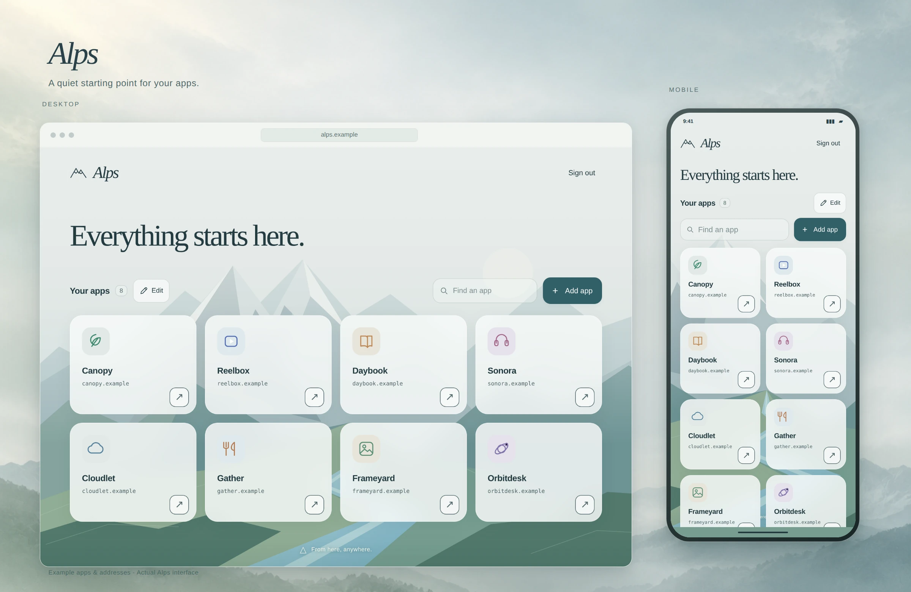

# Alps

A launcher for your home-network ~~alps~~ apps, with HTTPS and login protection for local apps (even if they didn't have any before).



## Install

Linux, Python 3.10+. No Python packages to install.

```sh
./install.sh
```

Choose `local` for this computer only, or `lan` for your home network, then set a
username and password. Setup prints the address to open. HTTPS uses port `443`;
local HTTP uses `8020` by default.

For `ips` / `lan+ips` access, see [network setup](docs/SETUP.md#who-can-connect).
For Tailscale with a trusted certificate, see [Tailscale HTTPS](docs/HTTPS.md#tailscale-name-with-a-trusted-certificate).

Run the installer again to update or change setup. Your apps stay saved.

## Local apps

With Alps set up for HTTPS, keep your app running on `localhost`, then for example:

```sh
alps expose http://127.0.0.1:3000 --name Notebook
```

This adds a launcher tile and prints an HTTPS address protected by your Alps login.
Only expose apps you trust. See [access details](docs/CLI.md#access).

## Docs

- [Setup and maintenance](docs/SETUP.md)
- [Using Alps](docs/USAGE.md)
- [Local apps and CLI](docs/CLI.md)
- [HTTPS and certificates](docs/HTTPS.md)

## License

[MIT](LICENSE) © 2026 Dimitris Bounias.
